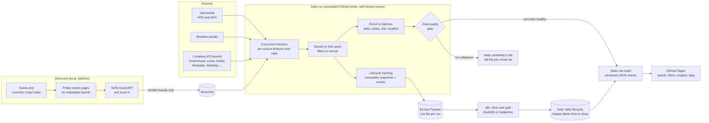

# Jobs Index: case study

A job-market data pipeline I designed and run on my own. Every day it collects
public job postings from job boards, Brazilian job portals and a few thousand
company career boards, tracks each posting over time, and publishes a free,
searchable site.

**Live site → [pedrororo.github.io/remote-jobs-index](https://pedrororo.github.io/remote-jobs-index/)** (rebuilt every day)

This repository is a write-up, not the pipeline. The pipeline code lives in a
private repository because its company and board lists are the result of
weeks of discovery work. What is here:

- the problem and the architecture;
- the design decisions, with what each one cost;
- the numbers;
- what broke and how I fixed it;
- [`sample/`](sample): a small runnable version of two core ideas (lifecycle
  snapshots and Kaplan-Meier time to close) on **fake data**, Python standard
  library only.

---

## The problem

Job seekers in Brazil and LATAM search a dozen sites and still miss most
postings. Most jobs are not on job boards: they sit on each company's own
applicant tracking system (ATS), such as Greenhouse, Lever, Ashby or Workday.
And no site answers the questions I cared about: how many jobs are really
remote, who hires entry-level people, how long a posting stays open.

So the goal was:

1. **Volume.** Read company ATS boards directly, not only aggregators. Cover
   remote, hybrid and on-site jobs, tech and non-tech, in Europe, the US, LATAM
   and Brazil.
2. **History.** Know when each posting first appeared, when it changed and when
   it closed, so the market can be measured, not only searched.
3. **No budget.** Run every day for free, with no servers to keep up, and stay
   correct when a source breaks.

## Architecture



Two repositories: the private pipeline (code, board lists, workflows, the
lifecycle state stored as a release asset) and a public Pages repository that
holds only the built site, force-pushed as a single commit every run.

## Design decisions and their trade-offs

### 1. Stream jobs to disk, enrich in batches

**Context.** The daily run was killed by the runner at about 7.2 GB of memory
with 149k jobs. The code held every job and description in memory, and the
history, enrichment and exports each made more copies. Peak memory grew with
the number of jobs, and I was about to add tens of thousands more.

**What I did.** First I trimmed: streamed the lifecycle state, stored
descriptions as a SHA-256 fingerprint, dropped raw HTML right after converting
it. That cut the state from 1.3 GB to 245 MB, but the peak only went from 7.2
to 6.15 GB, and it was still linear in job count. So I changed the design.
Each fetcher now hands jobs over as they arrive. An intake step writes the
snapshot, drops the HTML, applies the publication filters and appends the job
to a spool file on disk. Enrichment and the exports then read the spool in
batches of 5,000 jobs through one reused process pool.

**Result.** Peak memory went from **5.05 GB at 171k jobs to 2.81 GB at 232k
jobs**: 44% less memory with 36% more jobs. In CI it stayed between 2.8 and 3.3
GB at 386k to 401k jobs. The lifecycle state written by the new code was
byte-identical to the old one on the real 217k-row state.

**Cost.** More moving parts: a spool file and a batch loop instead of one list,
and every fetcher has to support the streaming hand-over. The enrichment cache
is keyed by a hash of the parser files, so editing a parser forces one slow,
memory-heavy run.

### 2. Immutable lifecycle snapshots

Each job gets a stable **identity hash** (source, company, posting id) and a
**content hash** (the fields that matter when they change). Every run writes an
append-only snapshot and one event per change: opened, updated, missing,
returned, closed, reopened. The current state keeps `first_seen_at`,
`last_seen_at` and the status.

- History is never rewritten. When I found a bug in how events were labeled,
  I fixed the derivation in silver and re-derived the old runs, without touching
  the raw files.
- A job is not closed when its source failed in that run. A broken fetcher must
  not look like thousands of jobs being filled.
- A job closes after three misses **and** at least 36 hours since the first
  miss (see "What failed" below).

**Cost.** Storage grows every day, and local runs and CI runs keep separate
states, so they describe two different histories and must not be mixed.

### 3. Bronze → dbt silver and gold, on DuckDB or Databricks

Each run's events become one immutable Parquet file (bronze). A dbt project
builds silver (events with the reason a job opened, an SCD Type 2 history of
every job, latest attributes) and gold (daily new postings and closures, time
to close). The same models run on two targets: DuckDB locally and in CI, in
seconds, and Databricks (Unity Catalog, Auto Loader, incremental SCD2 with
`MERGE`, a job defined as an Asset Bundle). Dialect differences live in six
adapter-dispatch macros.

**Why dbt.** The models used to be SQL strings rendered from Python, run in a
hard-coded order, fully rebuilt every day, with a second copy for Databricks.
dbt gave lineage, incremental models and tests next to the models: 19 data
tests (keys, one current version per job, contiguous versions, every run
present) and unit tests. Before deleting the old SQL I compared every table in
both directions with `EXCEPT ALL`: **0 differing rows** across six tables
(415,313 events, 356,025 SCD2 rows).

**Cost.** The Databricks job still runs a hand-written SQL copy of the models,
so a gold change is made twice, with a script that checks both engines agree.
Moving the job onto `dbt build --target databricks` is the next step. A
backfill older than the table is detected by a test, not handled
automatically.

### 4. Kaplan-Meier for "how long does a job stay open"

On any given day most jobs are still open. The median of closed jobs only
answers "how long did the jobs that already closed last", which favors short
postings. Kaplan-Meier counts open jobs as "lasted at least this long"
(right-censored). It runs in SQL: the survival curve is
`exp(sum(ln(1 - closed / at_risk)))` over a window ordered by days.

| Group (2026-10-21 history) | Jobs | Closed | Median days open (KM) | Median of closed only |
| --- | ---: | ---: | ---: | ---: |
| All new postings | 42,145 | 15,677 | **33** | 7 |
| ATS boards | 35,302 | 10,544 | **40** | 14 |

The closed-only median understates time open almost five times.

**Limits.** Only jobs first seen from a source I already collected count (for
the others, "first seen" is when I added the source). Disappearing from an RSS
feed is not closing: feeds list only recent items, so their jobs "close" in 0
to 3 days. ATS boards list every open job, so their closures are the ones that
mean something.

### 5. ATS discovery, in small verified batches

Most of the coverage comes from finding which companies use which ATS. The
discovery tools probe career pages for embedded boards, read the Common Crawl
URL index for public boards of every supported ATS, and take seed lists of
startups (I added over 1,700 VC-backed startups, because startups hire
entry-level people). A board joins the daily run only after its public API
answers with real jobs and a readable employer name. Each board is scored from
a sample of up to 50 jobs (share of tech, entry-level, remote and LATAM jobs),
and recruiters and aggregators are filtered out.

New boards go into a batch file, are fetched on their own, measured, and only
then merged. Conflicts with existing mappings are logged for review, never
overwritten.

**Cost.** Every batch makes the daily run longer, so growth is limited by the
run's time budget, not by discovery. Hand-picked lists of famous names hit
diminishing returns fast: large non-tech and Brazilian employers mostly use
Workday, local portals or their own sites.

### 6. A static site with no backend

The site is plain HTML, CSS and JavaScript with no build step, reading
versioned JSON (`data/v2/`): one shard per job category, rows as positional
arrays with dictionary-encoded fields, the newest 1,000 jobs in a small file
that loads first. Search, filters, an insights tab, SEO landing pages, a
sitemap and a blog all run on GitHub Pages.

- Full job descriptions are never published, only short extractive summaries
  with a link to the original posting.
- A layout change old pages cannot read means publishing `data/v3/`, not
  editing v2.
- The build fails, and nothing is published, if a shard is missing, counts do
  not match, or any file is over 40 MB.

**Cost.** No server-side search: everything a visitor filters has to be
downloaded first, so file size is a constant concern.

### 7. A data quality gate before publishing

Each run is compared with the median of the previous 7 runs: failed or empty
sources, volume drops, gaps between runs, slow runs. Medians, not means, so one
bad run does not shift the baseline. If the whole run collected less than half
the usual volume, **yesterday's site stays online** and the job fails, so I get
GitHub's failure email. The check step itself cannot block the site if it has a
bug.

### 8. A self-hosted runner on a free VM

The private repository has 2,000 free Actions minutes a month, and the daily
run alone needed about 4,300. I moved all workflows to a self-hosted GitHub
runner on an Oracle Cloud Always Free ARM VM (4 cores, 24 GB). GitHub still
schedules the runs and keeps the secrets, releases, cache and failure emails;
only execution moved. Cost so far: $0, with a $1 budget alert.

**Cost.** It is not faster (the fetch is network-bound), the ops are mine now,
and a self-hosted runner must never be attached to a public repository, where
any pull request could run code on it.

## Numbers

Counts change with every merge; these are from late October 2026.

| | |
| --- | --- |
| Company career boards | about 3,300 to 3,900, across 10+ ATS vendors |
| Jobs fetched per day | about 400k (386k exported to the site after one run) |
| Daily run | about 2 h 20 min for ~427k jobs, peak RAM ~4 GB on the VM |
| Peak memory after streaming | 2.81 GB at 232k jobs, down from 5.05 GB at 171k |
| Lakehouse verification | 0 differing rows across six tables, DuckDB vs old SQL |
| Tests | 150+ offline unit tests on every push, 19 dbt data tests, Kaplan-Meier unit tests |
| Cost | $0 a month |

## What failed, and how I fixed it

**The runner ran out of memory.** The first run with a large Brazilian portal
peaked at 7.2 GB and was killed. Swap and trimming bought headroom; the real
fix was streaming (decision 1).

**"Opened" did not mean "published".** Every job seen for the first time
produced an "opened" event, including all existing jobs of a newly added
source. Enabling one portal produced 64,844 "openings" in one day. Only 19% of
all openings were new postings from sources I already collected. Fix: every
opened event now carries a reason (`BASELINE`, `NEW_COHORT`, `NEW_POSTING`,
`BACKFILL`), and the market numbers only use `NEW_POSTING`.

**Jobs closed after three runs, not three days.** A job closed after three
misses in a row, so a few manual reruns on one day could close a job hours
after it went missing. On one day 2,557 of 2,630 closures came less than 24
hours after the first miss. Fix: closing also requires 36 hours since the
first miss. Older runs were re-derived in silver; bronze was not touched.

**Jobs came back without a trace.** A job that went missing and then
reappeared went back to open in the state without any event, so the history
could not say when it returned. I found it while building the SCD2 history:
815 jobs disagreed between the history and the state. Fix: a `JOB_RETURNED`
event, and every build reconciles the history with the state and logs the
differences.

**A source said "ok" for two months and returned nothing.** One job board
reported success with 0 jobs in all 52 runs I had, and the fetcher status hid
it. Running the new quality checks over that history found it, plus five days
when the ATS fetch nearly collapsed (for example 849 jobs instead of about
22,900), each of which would have published a near-empty site. The gate now
blocks those (decision 7).

**A config section that no run ever read.** I had written readable names for
hundreds of companies, but the daily run never loaded that section: 691 of 809
companies showed up as URL slugs on the site. Fix: the fetch step reads the
names from the same config it fetches from, with a test.

**My own Kaplan-Meier expectation was wrong.** Writing the unit test, I
computed the answer by hand first, and the median over all boards was 5 days,
not the 3 I expected. The test was right and my intuition was not, which is
why I now write the expected value by hand before running the code.

**Out of CI minutes.** The private repository was at 1,833 of 2,000 free
minutes, with a run that needs about 4,300 a month. Fix: the self-hosted runner
(decision 8).

## Still open

- Run the Databricks job from dbt and delete its SQL copy.
- Split the largest files (the ATS fetcher is about 2,300 lines).
- Measure each new batch of boards in the daily run before adding the next one.

## The sample

[`sample/`](sample) is a small, self-contained version of decisions 2 and 4,
on a fake job market. No network, no dependencies beyond Python 3.10+.

```bash
python3 sample/run_sample.py          # 30 fake daily runs, then Kaplan-Meier
python3 -m unittest discover -s sample -v
```

It shows the close rule ignoring a failed source, the reason on each opened
event, and the gap between the Kaplan-Meier median and the closed-only median.
See [sample/README.md](sample/README.md).

## Stack

Python · SQL · dbt · DuckDB · Databricks (Delta Lake, Unity Catalog, Auto Loader,
Asset Bundles) · Parquet · GitHub Actions · JavaScript

## License

The write-up and the sample code are under the [MIT license](LICENSE). Job
postings belong to their employers and the sites that published them; the
live site only indexes public listings and links back to them.
