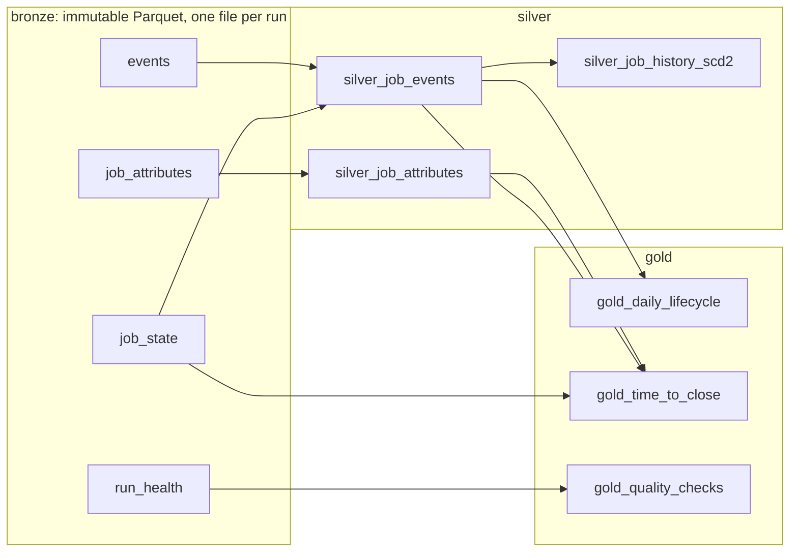

# dbt project: the real lakehouse models, on fake data

These are the dbt models, macros and tests that run in the private pipeline,
copied as they are. Only two things differ: `profiles.yml` reads every
Databricks setting from the environment, and bronze is written by
[`export_bronze.py`](export_bronze.py) from the fake job market in
[`../sample`](../sample) instead of by the daily run.

```bash
python3 -m venv .venv && . .venv/bin/activate
pip install -r dbt/requirements.txt
python dbt/export_bronze.py                         # 30 fake runs -> dbt/lakehouse/bronze
cd dbt && dbt build --profiles-dir .                # 10 models, 19 data tests, 2 unit tests
```

Run `dbt build` twice: the second run takes the incremental path of the
SCD Type 2 model. `dbt build --target databricks` builds the same models as
Delta tables when `DATABRICKS_HOST`, `DATABRICKS_HTTP_PATH` and
`DATABRICKS_TOKEN` are set.

## Data model



Staging views (`stg_*`) sit between bronze and silver. They fix the column
names and types the silver models rely on, whatever extra columns bronze has.

| Model | Grain | What it answers |
| --- | --- | --- |
| `silver_job_events` | one lifecycle event | Why did a job open (`BASELINE`, `NEW_COHORT`, `NEW_POSTING`, `BACKFILL`), and was a close reliable (missing ≥ 36 h)? |
| `silver_job_history_scd2` | job × version | What did a job look like at time T? Incremental; `MERGE` on Databricks, `delete+insert` on DuckDB |
| `silver_job_attributes` | job (SCD Type 1) | The latest classification: role family, seniority, remote scope |
| `gold_daily_lifecycle` | day | New postings vs coverage changes (new sources, baseline loads), closures, reopenings |
| `gold_time_to_close` | dimension × value | Kaplan-Meier median days open (open jobs right-censored) next to the biased closed-only median |
| `gold_quality_checks` | run × check × subject | ERROR / WARN / INFO per run; `run_volume_drop` blocks publishing |

### SCD Type 2 layout

| Column | Meaning |
| --- | --- |
| `job_tracking_id`, `version` | Unique key; versions are contiguous (tested) |
| `valid_from`, `valid_to` | When the version was first seen; when the next one started (`NULL` = current) |
| `is_current` | Exactly one per job (tested) |
| `status` | `OPEN`, `POSSIBLY_CLOSED` or `CLOSED` |
| `change_types`, `changed_fields` | What changed in that run (`JOB_UPDATED`, `JOB_REOPENED`...; `title`...) |
| `title`, `company`, `collector`, `company_key`, `link`, `run_id` | The attributes as of that version |

Point-in-time query: `valid_from <= T AND (valid_to IS NULL OR valid_to > T)`.

## What the fake data shows

On day 12 the fake ATS board fails. `gold_quality_checks` reports it:

```
source_failed    fake_ats_board  ERROR  Fetcher failed: HTTP 503 from the fake board
run_volume_drop  run             ERROR  9 jobs collected vs a median of 120: publishing is blocked
```

and, because a failed source says nothing about its jobs, none of them is
marked missing that day. The fake RSS feed only lists the last two days, so
the 7-run baseline also flags its volume as dropping on days 8 to 10: an
example of a check whose threshold needs tuning per source type.

`gold_time_to_close` for all new postings: Kaplan-Meier median **7 days**, against
a closed-only median of **2 days**. The closed-only median looks only at jobs
that have already closed, so it leaves out the ones that stay open longest.

## Tests

- **Data tests (19):** keys and not-null; one current SCD2 version per job;
  contiguous versions; every run that changed something is in the history;
  Kaplan-Meier counts add up.
- **Unit tests (2):** Kaplan-Meier counts still-open jobs; role families only
  cover jobs first seen after attributes were captured.
- **Cross-engine macros** ([`macros/cross_db.sql`](macros/cross_db.sql)): the
  six places where DuckDB and Spark SQL differ, dispatched per target.
